# NovelForge — local Android writing workspace

NovelForge 0.5.2 combines a flexible folder workspace with Overview, Plan, Write, Arrange and Read views. Markdown documents and linked story references remain local; manuscript order is independent from folder organization. Built with Kotlin, Jetpack Compose and Room. The redesigned interface uses compact sans-serif typography, charcoal/violet and light themes, geometric covers and short transitions.

## Screens

Actual Compose screens captured by the automated native-rendering test.

| Library | Workspace | Analytics |
| --- | --- | --- |
| 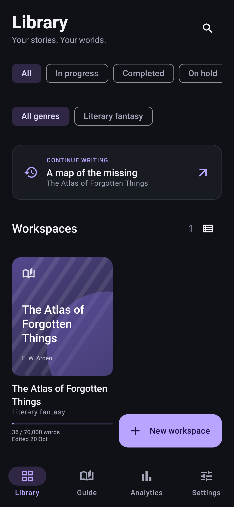 | 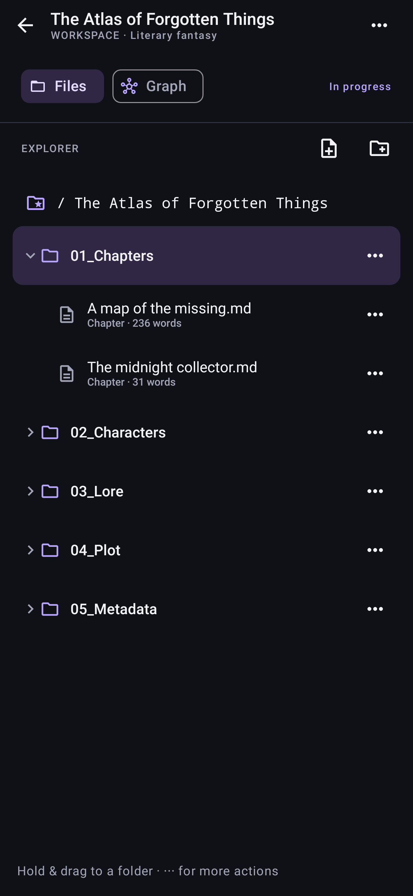 | 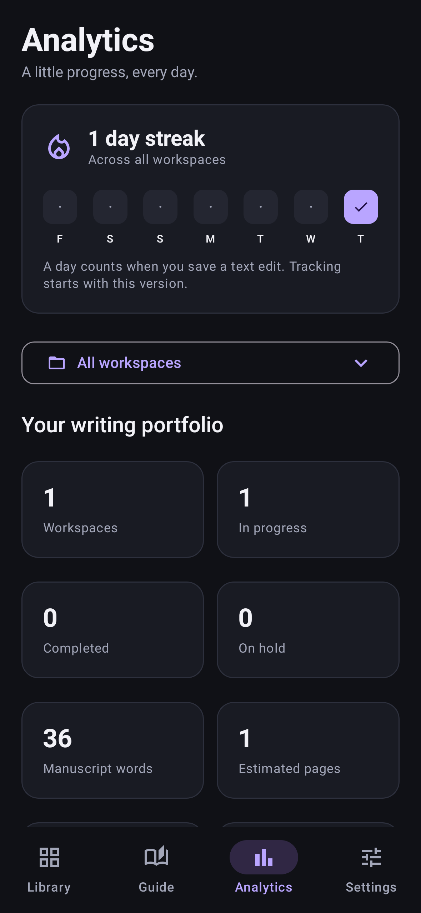 |

| Create workspace | Editor | Settings |
| --- | --- | --- |
| 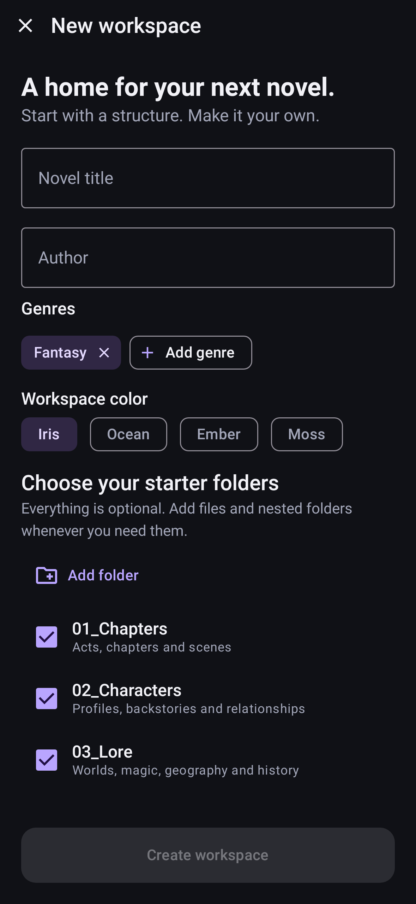 | 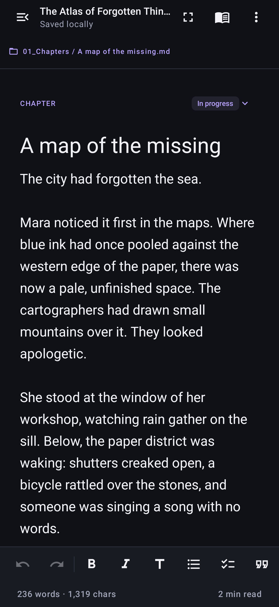 | 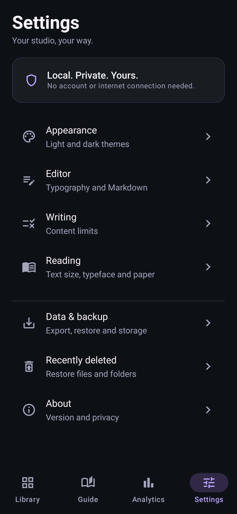 |

| Editor explorer |
| --- |
| 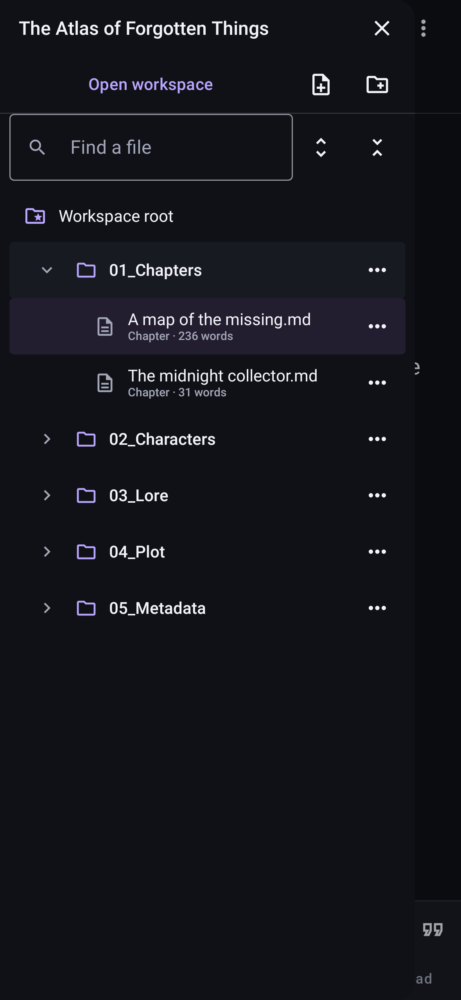 |

API 34 device captures:

| Details | Library filters | Overview guide |
| --- | --- | --- |
| 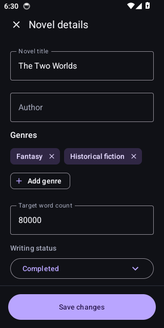 | 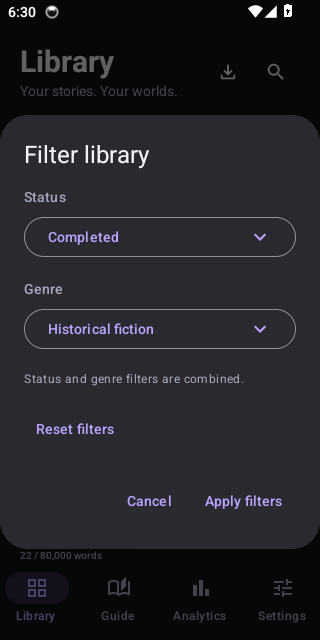 | 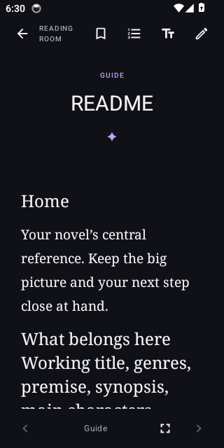 |

The 0.5 workspace views (API 34 device captures):

| Plan | Write | Arrange | Read |
| --- | --- | --- | --- |
| 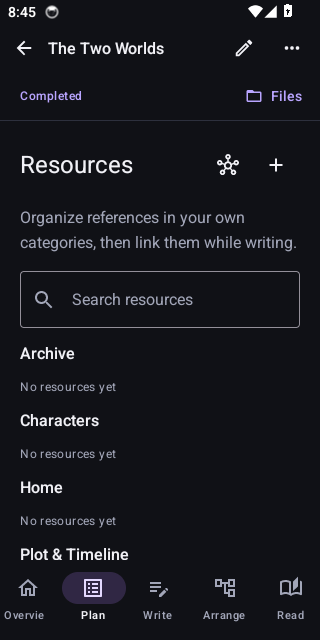 | 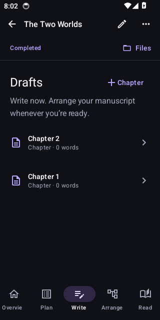 | 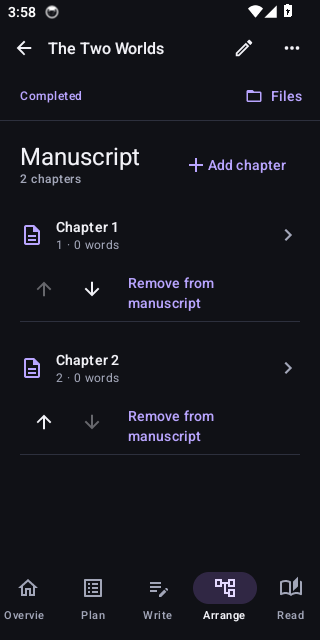 | 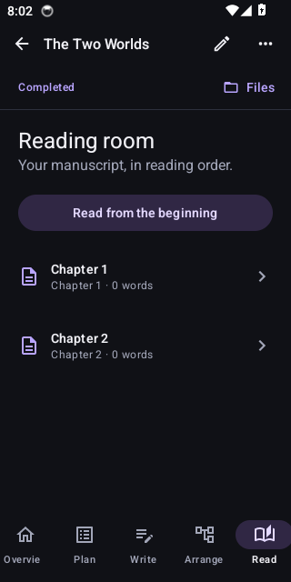 |

See [the UI/UX walkthrough](docs/REDESIGN.md) for each screen and its interactions.

## Architecture

A domain-based modular monolith with Clean Architecture boundaries, Hilt dependency injection and feature-specific MVVM/StateFlow. Plain Kotlin domains define contracts and rules; local repositories implement persistence; UI modules consume domain interfaces. See [ARCHITECTURE.md](docs/ARCHITECTURE.md) for module ownership, dependency direction and the steps for adding a feature.

## Navigation and features

- **Library:** grid/list workspaces, covers, combined status/genre filter dialog, header backup import, word goals, continue writing and global full-text search.
- **Guide:** five practical offline lessons on workspace structure, linking characters/worlds, scene planning, revision and backup.
- **Analytics:** writing streak above the workspace dropdown. All workspaces shows portfolio totals by status; one workspace shows manuscript progress, chapter states and story-bible statistics. Both include words, estimated pages, chapters, character profiles and daily activity.
- **Settings:** a category index leading to separate Appearance, Editor, Reading, Data & backup, Recently deleted and About screens.
- **Workspace setup:** Standard structure or Build from scratch. Standard creates eight beginner-friendly folders, editable README guides and two blank starter chapters; scratch starts empty. Customize future starter folders in Settings → Writing → Workspace structure.
- **Resources:** Plan groups references by real workspace folders. Its single + creates a resource in an existing or new category. Scratch has no preset taxonomy. External sources retain a URL and notes locally. Existing root files remain accessible as Uncategorized.
- **Synopsis:** Overview displays the story summary with a dedicated edit action and configurable word limit; Recent documents has been removed.
- **Workspace:** five focused views for the novel overview, story collections, drafts, manuscript arrangement and reading. The same file explorer is available throughout.
- **Manuscript:** Add chapter selects existing drafts through a searchable multi-select picker. Reorder independently of folders; Remove from manuscript keeps the source document. New drafts wait to be selected; existing/template membership is preserved. Reading, Markdown export and manuscript statistics follow inclusion. See [Arrange requirements and design](docs/ARRANGE_REQUIREMENTS.md).
- **Explorer:** compact flat rows, separate expand/select controls, search, expand/collapse all, active-file reveal, rename, move, sibling ordering, drag-to-folder and recoverable subtree deletion. The editor drawer includes create actions and an explicit close button.
- **Novel details:** a separate pencil action opens title, author, multiple genres and writing status. Synopsis belongs in the overview document. Overflow contains export, backup and confirmed permanent workspace deletion.
- **Writing:** autosave, syntax coloring, proportional/monospace choice, formatting toolbar, wiki-link picker, focus mode, undo/redo, checkpoints, backlinks and word/character/reading-time metrics.
- **Reading:** typography controls, warm paper, contents, bookmarks, remembered position and fullscreen controls.
- **Connections:** pan/zoom/tap graph plus a textual link list. Graph display caps at 40 nodes; the list retains all references.
- **Local-first data:** Room/SQLite, FTS search, portable JSON backups and Markdown manuscript export. No account, network permission or remote analytics service.

The explorer is a logical tree in the local database, not an external Markdown vault. Pages are estimated at 250 manuscript words. Writing history starts with 0.2; old streaks are not invented. Word additions measure positive net changes between saves.

## Verification and installation

The 0.5.2 build at source `12593a5158257d1c1917f2b1ce6c7fa264d340ba` passes compilation, architecture checks, 29 JVM tests, six API 34 Android tests and lint. [CI run 40060173193](https://github.com/iAdityaD/NovelForge/actions/runs/40060173193) retains the APK, reports and screenshots. Coverage includes atomic chapter selection, invalid/cross-workspace rejection, duplicate prevention, reopen persistence and the on-device remove/re-add picker flow.

Download the `NovelForge-debug` artifact and extract the APK, or use `NovelForge-v0.5.2-Android.zip` with installation instructions. Android 8.0 or newer is required. APK SHA256: `1567832ff02c8f83719582a07828eb797dd7120cc49685712ad09293e12a931c`.

**Before replacing an older development build, export each workspace backup outside app storage.** CI debug signing keys can differ between builds. If Android rejects the update because of its signature, only uninstall after securing your backups; install the new APK and restore them. Uninstalling deletes app-local data. Production distribution still requires a stable private signing key.

## Run

Open this repository in Android Studio, use JDK 17, install Android SDK 35, and run the `app` configuration. Android 8.0 (API 26) or newer is required.

```sh
./gradlew assembleDebug
./gradlew testDebugUnitTest lintDebug
```

The development APK is `app/build/outputs/apk/debug/app-debug.apk`. GitHub Actions builds and retains this APK after each successful push to main. Debug builds are for evaluation, not store distribution. Configure your own signing key for release builds.

## Data and safety

Room is the source of truth. Library and outline screens load summary projections; full text is loaded when opening a page. Edits are saved after a 400 ms pause, flushed before navigation, and flushed when the activity stops. A sudden process kill during the unsaved debounce window can still lose that latest fragment; the UI displays `Saving…` until persistence completes. Explicit save failures block editor navigation.

Project backups contain current active pages, metadata, and story structure. Restore creates a new project in one transaction, remapping page IDs, arc references, and wiki links. Imports are bounded to 16 MB / 10,000 entries and validate the format version and relationships. Backups do **not** include manual revisions, trash, bookmarks, reading positions, or appearance settings. Export outside app storage before uninstalling or changing devices. Android cloud backup is disabled deliberately.

No destructive database migrations are enabled. Schema exports live under `app/schemas`; future schema changes need explicit migrations and restore testing.

Room schema v4 migrates installed v1/v2/v3 databases without destructive fallback, preserving entry IDs, revisions, arc references and full-text search, and organizing existing pages into default folders. Backup v4 adds manuscript placement/inclusion and overview references to multiple genres, folder hierarchy and project status; v1/v2/v3 backups remain importable. Schema v3 added normalized BookGenre storage, preserving legacy genre strings as one value. Schema v4 adds independent manuscript placement and a stable overview document ID. Over-limit restored synopses remain intact. Backup imports do not restore writing streak history.

## Limits and next work

This is a functional development build. Physical-device frame-time, large-font and screen-reader certification remain pending. The screenplay template does not implement professional screenplay pagination. Reader rendering supports a Markdown subset rather than full CommonMark.

This is the first increment of the [full workspace upgrade plan](docs/WORKSPACE_UPGRADE_PLAN.md). Arrangement currently operates on chapters; nested scenes/parts, structured relationship editing and shared series are upcoming stages.

Future work includes complete snapshot backups, imported cover/media attachments, general Markdown-vault import, EPUB/PDF/DOCX export, reader pagination/highlights/TTS, revision diffs, richer link aliases, split-pane tablet navigation, scheduled external backups and release signing. Backups use Android's document picker; automatic cloud sync is not implemented.

## Resume work

Read `PROGRESS.md` and `docs/REDESIGN.md` first. Preserve existing data and user edits; commit each completed stage as requested by the owner.
