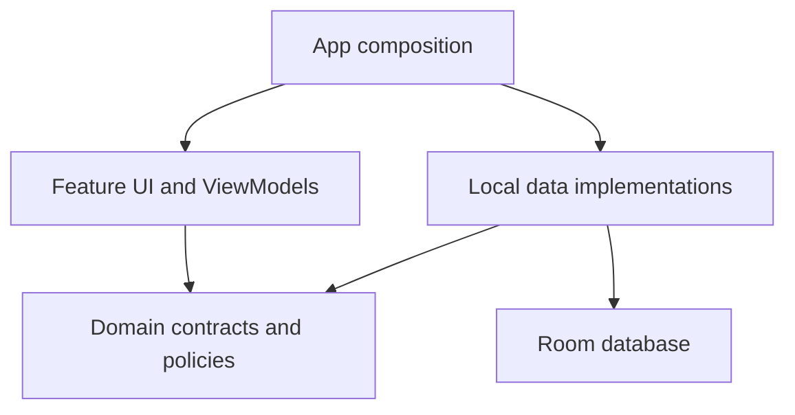

# NovelForge architecture (0.5)

NovelForge is a local-first modular monolith: one Android application assembled from independently bounded Gradle modules. Presentation uses MVVM and immutable StateFlow state. Domain contracts and policies are plain Kotlin; data implementations use Room and Android services. Hilt supplies implementations at the application boundary.

## Module ownership

| Module | Owns |
| --- | --- |
| `app` | Application/Activity, Hilt composition, typed destination enum, saved navigation IDs, Android document-picker launchers |
| `core:model` | Storage-independent Book, Entry, EntrySummary, Revision and WritingDay models; text counting/search token helpers |
| `core:database` | Room entities, DAO, database, frozen schema migrations |
| `core:designsystem` | Theme, typography, reusable cards, fields, icons, genre-chip input and display components |
| `core:presentation` | Small ViewModel coroutine/error foundation |
| `domain:workspace` | Workspace repository contract, folder hierarchy and metadata policies |
| `domain:writing` | Writing repository contract and shared editing session with autosave, undo/redo and flush coordination |
| `domain:story` | Story-reference contract and note templates |
| `domain:analytics` | Activity contract and streak calculations |
| `domain:preferences` | Typed preferences state and persistence contract |
| `domain:backup` | Portable backup/restore contract |
| `data:local` | Repository implementations, entity/model mappings, JSON wire codec, document IO and Hilt providers |
| `feature:library` | Library, workspace setup and search ViewModel |
| `feature:workspace` | Explorer, graph, novel details and workspace ViewModel |
| `feature:editor` | Markdown editing and editor ViewModel |
| `feature:reader` | Reader, bookmarks, positions and reader ViewModel |
| `feature:analytics` | Analytics UI and activity ViewModel |
| `feature:guide` | Offline guide lessons |
| `feature:settings` | Category settings, starter structure, trash and settings ViewModel |
| `feature:backup` | Backup progress/error orchestration |

## Dependency direction

Features depend on domain contracts, shared models, and shared UI infrastructure. They never depend on another feature implementation, Room, or `data:local`. Domain modules never import Android, Compose, Room or UI implementations. Data implements domain contracts. `app` assembles features and data through Hilt.

`scripts/check_architecture.py` enforces these boundaries in CI. Gradle enforces unresolved or circular module dependencies. Keep feature dependencies restricted to the capabilities actually used.

## State and editing

Each stateful feature owns its ViewModel. StateFlow exposes immutable state; Compose collects it with lifecycle awareness. Screens send events to the owning ViewModel. The app shell owns navigation and passes callbacks between features.

`EditorSession` is shared by editor and workspace operations because moving, renaming, deleting or exporting an open document must coordinate with pending edits. It has an injected process-lifetime coroutine scope, serializes saves, and flushes on navigation and Activity stop. Workspace mutations flush first and refresh the open document afterward. Storage rejects writes to trashed documents.

There is still a short 400 ms autosave debounce window. A forced process kill in that window may lose the unsaved fragment. A save failure remains visible and blocks normal editor navigation.

## Persistence and upgrades

Room schema history stays in `app/schemas/com.novelforge.app.data.ForgeDb`. The database class retains its canonical name for migration compatibility; SQL table names are explicit and independent of Kotlin entity names.

Schema 3 adds `BookGenre`, preserving the existing Book/Entry/Revision/FTS data. A legacy genre string becomes one genre value without guessing whether embedded punctuation was a delimiter. All genre writes are transactional with book metadata. New genre lists are trimmed and deduplicated without changing their displayed capitalization.

Domain objects are mapped explicitly to database entities. Backup JSON is a separate versioned wire format, currently v3, with v1/v2 readers. JSON restores remap IDs and internal links transactionally. Legacy synopsis metadata is preserved on migration and restore; the metadata form no longer edits it. New novel synopses belong in ordinary overview documents. Global preferences remain device-local and use the existing preference keys.

## Adding a feature

1. Decide which domain owns the behavior. Extend an existing module for a related capability; create a new module only for an independently evolving area.
2. Define storage-independent models, repository operations and meaningful validation policies in that domain. Avoid exposing DAO objects or Android Context.
3. Implement persistence in `data:local`. Add a versioned migration whenever the stored schema changes; preserve old backups.
4. Add a focused ViewModel and immutable UI state to the relevant feature. Inject contracts through its constructor.
5. Reuse the design system and pass navigation callbacks from `app`; avoid direct imports of sibling feature implementations.
6. Cover business rules and migration risks, then exercise the primary user flow. Run the boundary check and CI build.
7. Commit the stage and update `PROGRESS.md` with verified results and remaining work.

Example: character relationships belong to Story. Add relationship models and operations to `domain:story`, normalized storage and migration in `core:database`/`data:local`, and a UI owned by Workspace or a new Story feature. Editor can consume the Story contract for reference suggestions without importing that feature's screen.

## Deliberate scope

The local data implementations currently share one module and one database so cross-domain changes can remain transactional. The graph lives inside the workspace feature. Preferences use a typed abstraction over existing SharedPreferences to preserve installed user settings. Navigation uses typed enum destinations plus saved IDs rather than a new navigation framework. Split these further when a concrete feature requires it, without weakening the domain boundaries.

Production release signing, physical-device performance/accessibility review and the export/media roadmap remain separate work.

## Beginner workspace extension (0.5)

`StarterFolder` is a plain model with a stable role key, display name and enabled state. `domain:workspace` owns structure validation and guide content; `domain:story` owns optional document templates. Preferences persist the ordered structure as validated JSON. Settings edits future defaults without rewriting existing workspaces.

Creation inserts the workspace, logical folders and documents in one Room transaction. It returns the overview document ID to app navigation, which opens Guide documents in the existing reader. Scratch creation inserts only the workspace. Renaming a starter role preserves its purpose; actual documents retain their generated IDs across move/rename operations. No database schema change or new dependency was needed.

Whole-workspace deletion flushes and closes its active editing session, then transactionally removes the workspace and dependent database records. Reading references are cleared afterward. Existing per-document trash/restore remains separate from confirmed permanent workspace deletion.

## Workspace and manuscript foundation (0.5)

`domain:manuscript` owns placement contracts and canonical chapter ordering. Room schema 4 adds `ManuscriptPlacement` and the stable `Book.overviewId` reference. Migration preserves existing chapter IDs, content and order; folder position is no longer consulted once a chapter has a placement. New document insertion creates chapter placements transactionally.

WorkspaceStudio presents Overview, Plan, Write, Arrange and Read over shared documents. The app owns a shared modal explorer for workspace/editor/reader; closed drawers omit their contents from accessibility semantics. Plan filters canonical document types; Arrange moves or unplaces chapters without deleting their text. Reader contents and Markdown export use included chapters in manuscript order. Library and Analytics exclude unplaced chapters from manuscript totals while retaining all documents.

Portable backup v4 adds placement/inclusion and the overview reference; restores remap both to newly generated IDs. Older backup readers remain supported. Full snapshot backups, scene nesting, series and additional exports remain later roadmap stages.

### Resource categories (0.5.1)

A Plan category is an ordinary logical folder, identified by its stable entry ID. Standard and scratch workspaces use the same operation; their difference is the folders already present, not a hard-coded UI taxonomy. The folder picker uses full paths to distinguish nested names. Existing uncategorized documents are never automatically relocated.

`WorkspaceRepository.createResource` validates the destination, optional new folder, title and external URL, then creates the folder/document atomically in Room. `WorkspaceViewModel` owns in-flight state; `ResourceDialog` only collects input. The existing editor, linking, search and portable backup support Resource and External source kinds without a schema change. External content remains an explicitly supplied URL and notes, not a remote scraper or cached article.

The app shell consumes Scaffold insets before nested workspace navigation. Overview owns the synopsis display/edit entry point; the existing metadata policy and preferences remain the authority for word limits.
